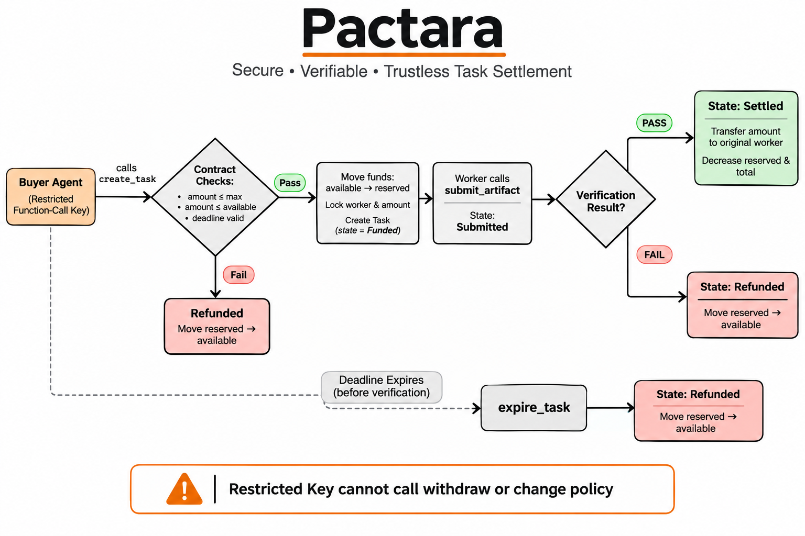

# Pactara

Agents can hire and pay other agents without being trusted with the money.

Pactara is a NEAR contract that holds a prefunded treasury, reserves funds when an agent creates a task, and releases payment only to the original worker after verification. The hiring agent uses a restricted function-call key and cannot withdraw, change the recipient, or override the rules.



This is infrastructure for the Agent Economy: a way for agents to transact safely under on-chain policy.

## How it works

```
Buyer Agent (restricted key)
        │
        ▼
   create_task
        │
        ▼
┌─────────────────────┐
│   Pactara Contract  │
│  available → reserved│
│  worker + amount    │
│  locked             │
└─────────────────────┘
        │
        ▼
   Worker submits artifact
        │
        ▼
   Verification
   ┌────┴────┐
   PASS     FAIL
   │         │
   ▼         ▼
 Pay worker  Refund
```

## Guarantees

- Prefunded treasury with available / reserved accounting
- Worker and amount fixed at task creation
- PASS settles to the original worker
- FAIL or expiry refunds to available balance
- Restricted key cannot call owner methods
- One submission per task

## Deployed

- Contract: `pactara-v2.testnet`
- Owner: `pactara-v2.testnet`
- Example worker: `ebubechukwucyber.testnet`

## Try it

### 1. Buyer agent hires with restricted key

```bash
chmod +x buyer_agent.sh
./buyer_agent.sh
```

Expected: a new task is created and funds are reserved. The agent cannot withdraw.

### 2. Unauthorized action is rejected

```bash
./demo.sh
```

Expected: the restricted key is rejected when it tries to call `withdraw`.

### 3. Check treasury and task state

```bash
near contract call-function as-read-only pactara-v2.testnet get_treasury json-args '{}' network-config testnet now
near contract call-function as-read-only pactara-v2.testnet get_task_state json-args '{"task_id":10}' network-config testnet now
```

## Tracks

- Primary: Agent Economy
- Secondary: AI Security & Defense

## Notes

- All testing is on testnet
- Verification is owner-gated for the MVP; a signed independent verifier can be added without changing settlement rules
- TEE and NEAR Intents are deferred

## Layout

```
├── src/lib.rs
├── Cargo.toml
├── buyer_agent.sh
├── demo.sh
└── README.md
```
