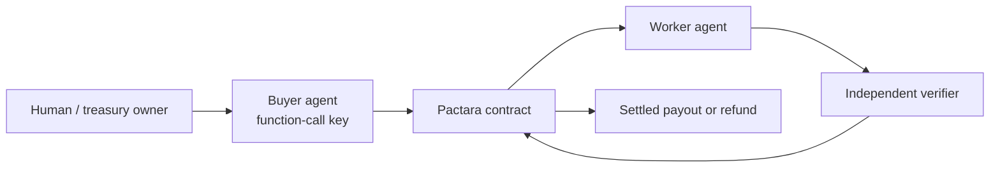

# Pactara

Independent, authorized verification with cryptographically enforced settlement on NEAR.

**AI agents can hire other agents, reserve funds under enforceable spending policies, and release payment only after a registered verifier signs the result.**

A valid signature proves the registered verifier signed that result. It does not prove the work is objectively correct.

## Problem

Agent-to-agent work needs escrow that cannot be overspent, and payout that cannot happen without a bound verification result. Human arbitration does not scale. Pactara is a small NEAR contract for that job, not a marketplace.

## How it works



1. Owner deposits NEAR. Only the owner or an authorized buyer may deposit. Withdrawals pay the owner.
2. An authorized buyer calls `create_task` (optionally with a function-call key limited to that method). The contract checks worker allowlist, per-task cap, daily cap, available funds, and deadline, then moves the amount `available → reserved`.
3. The named worker submits an artifact hash.
4. The verifier hashes canonical JSON, queries the on-chain task, checks its key and the contract signing message, and signs PASS or FAIL.
5. Anyone may submit that signature. PASS → `PayoutPending` → callback `Settled` (worker paid) or `Refunded` (transfer failed, funds restored). FAIL or expiry returns reserved funds to `available`.

The contract is the authority. Scripts only fail early.

## Treasury

`total == available + reserved + pending_out`

| Event | Effect |
|-------|--------|
| Deposit | `total` and `available` increase |
| Create task | `available → reserved`, `daily_spent` increases |
| PASS | `reserved → pending_out` |
| Payout success | `pending_out` and `total` decrease, state `Settled` |
| Payout/FAIL/expiry | amount returns to `available`; same-day `daily_spent` restored |
| Withdraw | `available → pending_out`; success drops `total`; failure restores `available` |

`get_health` reports whether that identity still holds. Callbacks never panic after the predecessor check (a panic would strand a completed transfer). An impossible underflow sets `accounting_fault` and is visible on `get_health`.

## Verification

Signing message:

`pactara-v1 || network_id || contract_account || task_id_le || criteria_hash || input_hash || artifact_hash || pass_flag`

Canonical JSON (buyer, worker, verifier):

`json.dumps(obj, sort_keys=True, separators=(",", ":"), ensure_ascii=True)` then SHA-256.

Evaluator subset (**not** JSON Schema): `schema` map of fields with `type` in `string|integer|number|boolean|object`, plus `required`, `minLength`, `maxLength`, `min`, `max`, `properties`, `required_keys`. Any other keyword is rejected before signing.

## Buyer restricted key

The contract sees the **buyer account**, not which access key signed. Policy is enforced on-chain regardless of keys.

Off-chain, `buyer_agent.sh` uses NEAR RPC `view_access_key_list` to require:

- key `account_id` equals `PACTARA_BUYER`
- public key installed on that account
- `FunctionCall` (not FullAccess)
- `receiver_id` equals the contract
- methods are exactly `create_task` (empty method list is rejected)

```bash
export PACTARA_CONTRACT=...
export PACTARA_BUYER=...
export PACTARA_WORKER=...
export PACTARA_RESTRICTED_KEY=/path/to/create_task_only.json
./buyer_agent.sh
```

Inspect: `near account list-keys "$PACTARA_BUYER" network-config testnet now`

## Demo

Requires `near-cli-rs`, `pip install -r requirements.txt`, and a deployment whose `get_code_version` is **`pactara-2.1.0`**.

```bash
export PACTARA_CONTRACT=<fresh-account.testnet>   # do not in-place upgrade pactara-v9
export PACTARA_SIGNER=$PACTARA_CONTRACT
export PACTARA_WORKER=<worker.testnet>
./demo.sh pass    # Scenario A: Settled
./demo.sh fail    # Scenario B: Refunded
./demo.sh deny    # Scenario C: on-chain rejections
```

Scripts abort if the on-chain state is not `Settled` / `Refunded`. They never print success first.

Payout/withdraw **callback recovery** is covered by Rust unit tests (mocked receipts). A live failed NEAR transfer is not always reproducible on testnet.

## Tests and build

```bash
cargo fmt
cargo test --lib
cargo build --target wasm32-unknown-unknown --release
python3 verifier.py self-test
python3 test_verifier.py
bash -n demo.sh buyer_agent.sh
```

## Deployment

`get_code_version` = `pactara-2.1.0`. `pactara-v9.testnet` is older bytecode. Deploy this wasm to a **new** account (state layout changed).

```bash
cargo build --target wasm32-unknown-unknown --release
near contract deploy <NEW_ACCOUNT> \
  use-file target/wasm32-unknown-unknown/release/pactara_contract.wasm \
  with-init-call new \
  json-args '{"owner":"<NEW_ACCOUNT>","max_amount_per_task":"1000000000000000000000000","daily_limit":"5000000000000000000000000"}' \
  prepaid-gas '100 Tgas' \
  network-config testnet sign-with-keychain send
```

## What is implemented vs not

| Implemented | Not implemented |
|-------------|-----------------|
| Allowlists, spending limits, hash-bound tasks | TEE / hardware attestation |
| ed25519 verifier + domain-separated message | Multi-verifier / threshold |
| Payout and withdraw callbacks | Objective work evaluation |
| Restricted-key buyer script | Marketplace, extra tokens, arbitration UI |

## Evidence

| Kind | Status |
|------|--------|
| Rust unit tests | Local, including callback recovery |
| Python verifier tests | Local |
| Testnet `pactara-v9.testnet` | Old code; not this version |
| Live PASS/FAIL/deny on this wasm | Requires a fresh deploy |

## Limitations

- One owner-chosen verifier key.
- Documents are off-chain; only hashes are stored.
- Signed PASS is a bearer credential until the task nonce is used.
- `PayoutPending` is not expired or retried (retrying the transfer could double-pay).
- Restricted keys are a NEAR account feature; the contract authorizes accounts, not key ids.
- Not a production-audited system.
