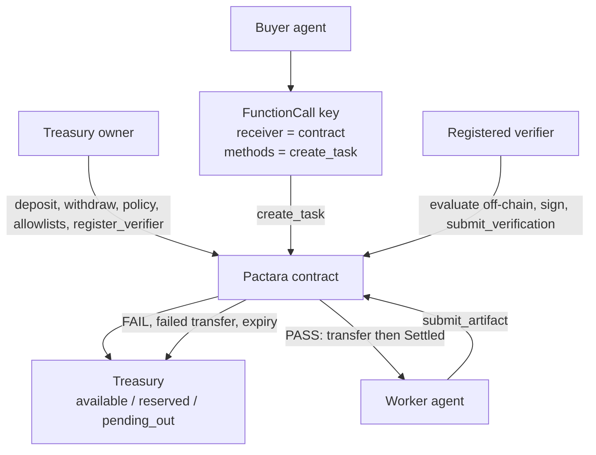
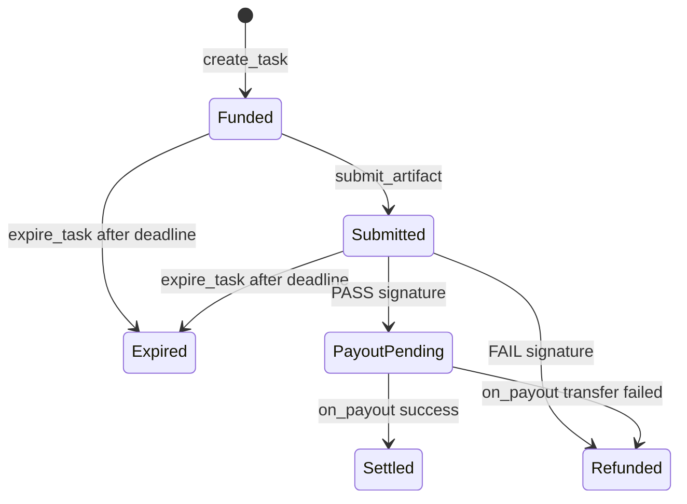

# Pactara

**Escrow, policy, and signed settlement for agent-to-agent work on NEAR.**

Autonomous agents can hire other agents, lock funds under spending limits, and release payment only after a registered verifier signs a bound PASS or FAIL. The contract is the authority. Off-chain scripts fail early; they do not replace on-chain checks.

A valid signature proves that the **registered verifier key** signed that result. It does not prove the work is objectively correct, hardware-attested, or decentralized.

**Code version:** `pactara-2.2.0` · **Network in this repo’s live deploy:** [pactara-v10.testnet](https://explorer.testnet.near.org/accounts/pactara-v10.testnet)

---

## Why this exists

Agents already call APIs, write artifacts, and move value. What they still lack is a small, enforceable execution layer:

- A **buyer agent** must commit funds without handing a worker a blank cheque.
- A **worker agent** must see that payment is reserved before it spends compute.
- Completion needs a **verification outcome bound to hashes**, not a chat message that says “done”.
- Settlement must not mark a task paid until the **transfer callback** succeeds.
- If arithmetic or balances become inconsistent, the contract must **stop unsafe financial operations** instead of clamping numbers into a fake healthy state.

Ordinary peer-to-peer NEAR transfers do not provide that. A marketplace, token, or arbitration UI is not required to solve it. Pactara is infrastructure for that job: reserve, bind, verify, settle.

---

## The problem

When one agent pays another for work:

| Need | What goes wrong without a contract |
|------|-------------------------------------|
| Buyer commits funds | Worker has no guarantee the buyer still has the money after the job |
| Worker delivers an artifact | Buyer can refuse to pay, or pay a different account |
| “Verification” | Any party can claim PASS with a different document than the one hashed at task creation |
| Spending policy | A compromised buyer key can drain a treasury |
| Failure | Refunds, failed transfers, and retries can double-pay or invent balances |

Human arbitration does not scale to machine-speed hiring. Pactara does not claim to replace judgment. It makes **reservation, authorization, hashes, signatures, and settlement order** enforceable.

---

## The solution

Pactara is a NEAR contract plus thin off-chain helpers.

**On-chain (enforced):**

- Owner deposits NEAR into a treasury. Authorized buyers may also deposit. Withdrawals always pay the **owner**.
- Allowlists for buyers and workers; per-task cap and UTC daily cap.
- `create_task` moves `available → reserved` and records SHA-256 hashes of criteria and input.
- Named worker submits an artifact hash (`Funded → Submitted`).
- Anyone may submit a 64-byte ed25519 signature over a domain-separated message. PASS moves `reserved → pending_out` and starts a transfer (`PayoutPending`). FAIL restores reserved funds (`Refunded`).
- The payout callback marks `Settled` only after a successful transfer, or `Refunded` if the transfer failed (balances restored once).
- `expire_task` after the deadline on `Funded` or `Submitted` → `Expired` (funds restored). `PayoutPending` is not expired or retried.
- Invariant: `total == available + reserved + pending_out`. Broken arithmetic is not clamped; `accounting_fault` freezes later treasury mutations.

**Off-chain (preflight only):**

- [`buyer_agent.sh`](buyer_agent.sh) + [`pactara_rpc.py`](pactara_rpc.py) inspect the buyer’s access key over RPC (`view_access_key_list`) and refuse to sign if it is not FunctionCall `create_task` only.
- [`verifier.py`](verifier.py) hashes canonical JSON, evaluates a **small** criteria subset, matches `get_signing_message`, and submits the signature.
- [`demo.sh`](demo.sh) drives pass / fail / deny scenarios and **queries on-chain state** before printing success.

The contract sees the **predecessor account**, not which access key signed the transaction. Restricting a key is a NEAR account feature plus an off-chain check. On-chain policy still applies if a FullAccess key is used.

---

## Why Pactara?

| Differentiator | What the code actually does |
|----------------|-----------------------------|
| **Agent-native execution** | Buyer, worker, and verifier are accounts and scripts around one contract, not a human checkout UI. |
| **Escrow before work** | `create_task` requires available funds and moves them to `reserved` before `Funded`. |
| **Policy-controlled buyer** | Allowlist, per-task and daily limits on-chain; optional FunctionCall key limited to `create_task`. |
| **Verification-driven settlement** | Worker cannot self-pay. PASS/FAIL is a registered-key signature over hashes + network + contract + task id. |
| **Explicit payout lifecycle** | PASS is `PayoutPending` until `on_payout`. Success is `Settled`; failed transfer is `Refunded` once. |
| **Accounting fault protection** | No silent clamp to zero. First fault reason is stored; deposit/withdraw/create/verify/expire refuse further unsafe ops. |
| **Clear trust boundary** | Signature = authorized verifier signed this message. Not TEE, not quorum, not objective truth. |

---

## Architecture



### Task lifecycle

Implemented states: `Funded`, `Submitted`, `PayoutPending`, `Settled`, `Refunded`, `Expired`.



`PayoutPending` cannot be expired. Re-issuing the same transfer would risk a double pay.

---

## How it works

1. **Fund the treasury.** Owner (or an authorized buyer) calls `deposit`. Withdrawals are owner-only and pay the owner, not an arbitrary recipient.
2. **Authorize participants.** Owner adds workers (and extra buyers if needed) and registers one ed25519 verifier public key.
3. **Buyer creates a task.** `create_task(worker, amount, criteria_hash, input_hash, verification_deadline)` checks: caller is an authorized buyer, worker is authorized, `0 < amount ≤ max_amount_per_task`, amount ≤ available, daily spend would not exceed `daily_limit`, deadline is strictly in the future. Then `available → reserved`, `daily_spent` increases, state `Funded`.
4. **Worker submits work.** Only the named worker may `submit_artifact` while `Funded` and before the deadline. State becomes `Submitted`. Documents stay off-chain; the contract stores the hash.
5. **Verifier evaluates.** It loads criteria/input/artifact JSON, hashes with canonical `json.dumps(..., sort_keys=True, separators=(",", ":"), ensure_ascii=True)`, checks the on-chain task, network id vs `NEAR_NETWORK` / known RPC, protocol id `pactara-v1`, code version, and `get_signing_message`.
6. **Settlement path.** Anyone may `submit_verification` with the 64-byte signature.
   - **PASS:** nonce consumed, `reserved → pending_out`, state `PayoutPending`, NEAR transfer to the worker, then `on_payout`.
   - **FAIL:** reserved returned to `available`, same-day `daily_spent` restored, state `Refunded`.
7. **Callback.** `on_payout` is `#[private]` (predecessor must be the contract). Success: `pending_out` and `total` decrease, `Settled`. Failure: `pending_out` restored to `available`, `Refunded`. Duplicate callbacks are no-ops because the pending map entry is removed once. Callbacks do not panic after the predecessor check (a panic can strand a completed transfer).
8. **Expiry.** After `verification_deadline`, `expire_task` on `Funded` or `Submitted` restores funds and sets `Expired`. The same task cannot be expired twice.

If checked arithmetic cannot be applied, the mutation is skipped, `accounting_fault` is set with the first reason, and `get_health` reports it. Later `deposit`, `withdraw`, `create_task`, `submit_verification`, and `expire_task` abort with `Accounting fault`.

---

## Security and trust model

### On-chain

- **Accounts, not key ids.** `create_task` authorizes `env::predecessor_account_id()`. NEAR does not expose “this FunctionCall key” to the contract.
- **Allowlists and caps.** Unauthorized buyers/workers, zero amounts, over-max, over-daily, insufficient available, and past deadlines are rejected.
- **Hash binding.** Verification must replay the exact criteria, input, and artifact hashes stored on the task.
- **Verifier key.** `env::ed25519_verify` against the owner-registered key. Message: `pactara-v1 || network_id || contract_account || task_id_le || criteria_hash || input_hash || artifact_hash || pass_flag`.
- **Nonce.** A used nonce cannot be verified again (`Submitted` + `nonce_used`).
- **Callbacks.** `on_payout` / `on_withdraw` require contract predecessor. Pending ids are consumed once.
- **Reserved funds.** Owner `withdraw` spends only `available`, so reserved escrow cannot be withdrawn.
- **Fault freeze.** Inconsistent treasury or failed checked math sets `accounting_fault` rather than inventing a balance.

### Off-chain preflight (not a substitute for the contract)

[`pactara_rpc.py`](pactara_rpc.py) `check-buyer-key` requires all of:

- Public key installed on the configured buyer account
- Permission is FunctionCall, not FullAccess
- `receiver_id` equals the Pactara contract
- `method_names == ["create_task"]` (extra methods and empty lists are rejected)

[`verifier.py`](verifier.py) refuses unsupported criteria keywords, mismatched hashes, wrong registered pubkey, wrong protocol/code version, and `NEAR_NETWORK` / well-known RPC URLs that disagree with `get_network_id`.

### What this is not

Not fully trustless, not multi-verifier, not TEE-backed, not formally verified, not a production audit. The verifier is a **trusted signer** chosen by the owner.

---

## Technology stack

| Piece | Role in this repo |
|-------|-------------------|
| [NEAR Protocol](https://near.org) + [near-sdk 5.30](https://github.com/near/near-sdk-rs) | Contract, promises, ed25519 verify, `LookupMap` |
| Rust (`cdylib` + `rlib`) | WASM for chain, native `cargo test --lib` |
| Python 3 + PyNaCl + base58 | Verifier hashing, signing, RPC helpers, tests |
| [near-cli-rs](https://github.com/near/near-cli-rs) (`near`) | Demo, buyer script, deploy, view calls |
| Bash | [`demo.sh`](demo.sh), [`buyer_agent.sh`](buyer_agent.sh) |

`package.json` pins npm `near-cli`; **scripts in this README use `near-cli-rs`**. There is no frontend, no extra token, no GitHub Actions workflow in this tree.

---

## Repository layout

```
pactara/
├── src/lib.rs              # Contract: treasury, tasks, callbacks
├── src/tests.rs            # Native unit tests (mocked receipts)
├── Cargo.toml / Cargo.lock
├── verifier.py             # Hash, evaluate, sign, submit
├── pactara_rpc.py          # JSON-RPC views + exact buyer-key check
├── test_verifier.py
├── test_pactara_rpc.py
├── test_integration.py     # Buyer-key + hash/message composition (no chain)
├── buyer_agent.sh          # Restricted-key create_task
├── demo.sh                 # Testnet pass / fail / deny
├── requirements.txt        # pynacl, base58
└── README.md
```

---

## Installation and setup

### Prerequisites (local)

- Rust toolchain with target `wasm32-unknown-unknown`
- Python 3
- `near` ([near-cli-rs](https://github.com/near/near-cli-rs)), for demo and deploy only

### Clone and Python deps

```bash
git clone https://github.com/Ebubechukwucyber/pactara.git
cd pactara
python3 -m venv .venv
source .venv/bin/activate   # Windows: .venv\Scripts\activate
pip install -r requirements.txt
```

### Build and test (local, no NEAR account required)

```bash
cargo fmt --check
cargo test --lib
cargo build --target wasm32-unknown-unknown --release
python3 verifier.py self-test
python3 test_verifier.py
python3 test_pactara_rpc.py
python3 test_integration.py
bash -n demo.sh buyer_agent.sh
```

WASM output: `target/wasm32-unknown-unknown/release/pactara_contract.wasm`

### Environment variables

| Variable | Used by | Meaning |
|----------|---------|---------|
| `PACTARA_CONTRACT` | demo, buyer | Contract account (default `pactara-v10.testnet`) |
| `PACTARA_SIGNER` | demo | Signer for owner-style calls (default: contract) |
| `PACTARA_WORKER` | demo, buyer | Worker account |
| `PACTARA_BUYER` | buyer | Buyer account; must match key file `account_id` |
| `PACTARA_RESTRICTED_KEY` | buyer | Path to FunctionCall key JSON (**required**) |
| `PACTARA_AMOUNT` | buyer | Task amount in yoctoNEAR |
| `NEAR_NETWORK` | demo, buyer, verifier | Must match contract `get_network_id` when set |
| `NEAR_RPC_URL` | verifier, RPC helper | Optional; well-known mainnet/testnet URLs must match `network_id` |
| `PACTARA_VERIFIER_KEY_FILE` | verifier | Preferred signing-key path (mode `600` expected) |
| `PACTARA_VERIFIER_SK` | verifier | Hex/base58 seed; discouraged vs file |
| `PYTHON` | demo, buyer | Python executable if not `python3` |

Do not pass private keys on the command line.

---

## Testing and verification

Counts below are **tests defined in this repository** (asserted by `#[test]` / `def test_`):

| Suite | File | Cases |
|-------|------|--------|
| Rust contract | [`src/tests.rs`](src/tests.rs) | 40 |
| Verifier | [`test_verifier.py`](test_verifier.py) | 16 |
| Buyer-key RPC mocks | [`test_pactara_rpc.py`](test_pactara_rpc.py) | 7 |
| Combined helpers | [`test_integration.py`](test_integration.py) | 1 |

Coverage includes unauthorized actors, hash/signature mismatch, replay, expiry, overflow, duplicate callbacks, accounting-fault freeze, exact `create_task` key shape, and network/RPC mismatch.

Live-chain evidence is in **Testnet evidence** below. Local command results from this tree: `cargo test --lib` (40 passed), Python suites listed above, and the WASM release build. Re-run the commands in **Installation** to reproduce.

---

## Demo (testnet)

Requires `near-cli-rs`, Python deps, a signer in the keychain, and a contract whose `get_code_version` is **`pactara-2.2.0`**. Do **not** in-place upgrade `pactara-v9.testnet` (state layout changed).

```bash
export PACTARA_CONTRACT=pactara-v10.testnet
export PACTARA_SIGNER=$PACTARA_CONTRACT
export PACTARA_WORKER=<authorized-worker.testnet>
export NEAR_NETWORK=testnet

./demo.sh pass    # A: query state Settled
./demo.sh fail    # B: query state Refunded
./demo.sh deny    # C: unauthorized calls must fail on-chain
```

The demo creates hashes and deadlines at runtime, prints `get_treasury` / `get_health`, and **exits non-zero** if the task is not `Settled` or `Refunded`. Reaching the last line is not treated as success by itself.

Failed NEAR transfers are not always reproducible on testnet. Callback recovery is covered by Rust tests with mocked `PromiseResult`.

### Restricted-key buyer (testnet)

```bash
export PACTARA_CONTRACT=pactara-v10.testnet
export PACTARA_BUYER=<buyer.testnet>
export PACTARA_WORKER=<worker.testnet>
export PACTARA_RESTRICTED_KEY=/path/to/create_task_only.json
./buyer_agent.sh
```

Inspect keys: `near account list-keys "$PACTARA_BUYER" network-config testnet now`

---

## Deployment

Deploy **new** accounts. `new` defaults `network_id` to `testnet`. Use `new_with_network` if the signing domain must be another network id.

```bash
cargo build --target wasm32-unknown-unknown --release
near contract deploy <NEW_ACCOUNT> \
  use-file target/wasm32-unknown-unknown/release/pactara_contract.wasm \
  with-init-call new \
  json-args '{"owner":"<NEW_ACCOUNT>","max_amount_per_task":"1000000000000000000000000","daily_limit":"5000000000000000000000000"}' \
  prepaid-gas '100 Tgas' \
  attached-deposit '0 NEAR' \
  network-config testnet sign-with-keychain send
```

Then: `deposit`, `add_authorized_worker`, `register_verifier`.

### Status of capabilities

| | |
|--|--|
| **Implemented** | Allowlists, caps, hash-bound tasks, ed25519 verifier, PASS/FAIL, `PayoutPending`, callback recovery, accounting fault freeze, restricted-key buyer script |
| **Locally tested** | 40 Rust + 16 + 7 + 1 Python tests; WASM release build |
| **Testnet verified** | `pactara-v10.testnet` running `pactara-2.2.0` (see evidence) |
| **Planned / out of scope** | TEE, multi-verifier, marketplace, extra token, arbitration UI, objective work evaluation |

### Testnet evidence (`pactara-2.2.0` on `pactara-v10.testnet`)

| Event | Link |
|-------|------|
| Deploy + `new` | [4bMeQ7ExY1hWGZaqN24kSu273WGVbQR7TyMcEC6zztU6](https://explorer.testnet.near.org/transactions/4bMeQ7ExY1hWGZaqN24kSu273WGVbQR7TyMcEC6zztU6) |
| PASS task 4 `Settled` (payout to worker) | [3u4s3X9HGevoiXgB9EYCwRXzBcZi4RdnvvNCu1RgWHtm](https://explorer.testnet.near.org/transactions/3u4s3X9HGevoiXgB9EYCwRXzBcZi4RdnvvNCu1RgWHtm) |
| FAIL task 5 `Refunded` | [Bf7CMJVfUzorchVog81jCEu8d8JG2YhsywV6wqWFjzU4](https://explorer.testnet.near.org/transactions/Bf7CMJVfUzorchVog81jCEu8d8JG2YhsywV6wqWFjzU4) |
| Deny | Unauthorized worker, over-limit amount, worker `set_policy`, worker `withdraw` rejected on-chain |

WASM SHA-256 at deploy (account summary): `8c4836e27e1e1abe381f728c0680daaa443347fa3a2a08355e992072db252233`

---

## Treasury reference

`total == available + reserved + pending_out`

`get_health` → `(healthy, total, available, reserved, pending_out, fault_reason)`

| Event | Balances |
|-------|----------|
| Deposit | `total` and `available` increase |
| Create task | `available → reserved`; `daily_spent` increases |
| PASS | `reserved → pending_out` |
| Payout success | `pending_out` and `total` decrease; `Settled` |
| Payout fail / FAIL / expiry | amount to `available`; same UTC day restores `daily_spent` |
| Withdraw | `available → pending_out`; success drops `total`; failure restores `available` |

---

## Acceptance criteria (verifier)

Not JSON Schema. Top-level object `{"schema": { field: rule, ... }}`.

Allowed rule keys: `type`, `required`, `minLength`, `maxLength`, `min`, `max`, `properties`, `required_keys`.  
Allowed types: `string`, `integer`, `number`, `boolean`, `object`.  
Python `bool` is not an integer. Any other keyword is rejected before signing.

---

## Limitations and next steps

These are design choices, not unfinished TODOs in the happy path:

- **One owner-registered verifier.** The signature authenticates that key, not a majority or a TEE.
- **Off-chain documents.** Only SHA-256 hashes live on-chain.
- **Bearer PASS.** Until the task nonce is consumed, a valid signature can be submitted by anyone.
- **No retry on the same task id** after FAIL, failed payout, or expiry.
- **Do not retry `PayoutPending` transfers.**
- **Restricted keys are optional hygiene.** The contract still accepts `create_task` from any authorized buyer account.
- **Not production-audited.**

Possible later work (not implemented): additional verifiers, hardware attestation, iterable accounting recovery transactions, a marketplace UI.

---

## Closing

Agent-to-agent commerce needs a boring property: **money moves when a bound verification says so, and not when a script prints “success.”** Pactara keeps that property small enough to read, test, and demonstrate on NEAR testnet—escrow, policy, signature, callback—without pretending to be a full agent economy.

Use it as a settlement primitive. Do not treat it as a substitute for independent operational security or a third-party audit.
